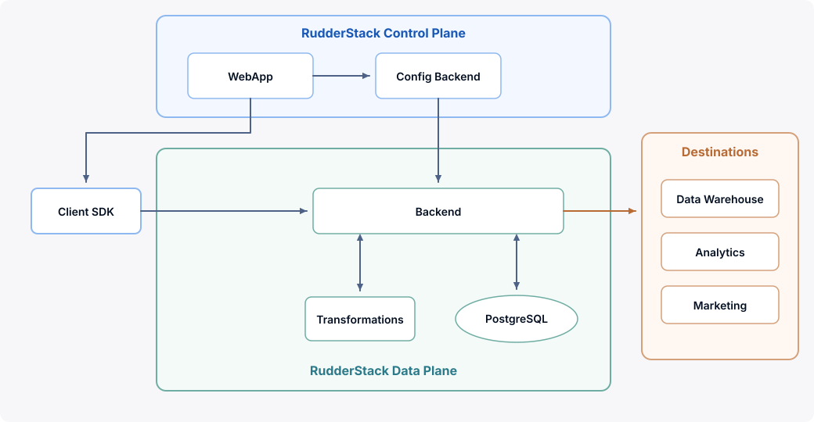

<!-- HEADER: rudderlabs README header template. Source: devrel brand/github-readme-header/TEMPLATE.md -->
<p align="center">
  <a href="https://www.rudderstack.com/?utm_source=github&utm_medium=readme&utm_content=rudder-server-logo">
    <picture>
      <source media="(prefers-color-scheme: dark)" srcset="resources/rudderstack-logo-white.svg">
      
    </picture>
  </a>
</p>

<h3 align="center">Reliable, programmable customer event pipelines on your infra</h3>

<p align="center">
  <a href="https://github.com/rudderlabs/rudder-server/stargazers"></a>
  <a href="https://github.com/rudderlabs/rudder-server/releases"></a>
  <a href="https://hub.docker.com/r/rudderlabs/rudder-server"></a>
  <a href="https://github.com/rudderlabs/rudder-server/actions/workflows/builds.yml"></a>
  <a href="LICENSE"></a>
</p>

<p align="center">
  Collect events from every app, enforce consent, transform them in flight, and deliver them to your warehouse and 200+ tools. Warehouse-native, agent-ready, Segment API compatible.
</p>

<p align="center">
  <b>
    <a href="https://www.rudderstack.com/?utm_source=github&utm_medium=readme&utm_content=rudder-server-nav">Website</a> ·
    <a href="https://www.rudderstack.com/docs/?utm_source=github&utm_medium=readme&utm_content=rudder-server-nav">Docs</a> ·
    <a href="https://github.com/rudderlabs/rudder-agent-skills">Agent Skills</a> ·
    <a href="https://github.com/rudderlabs/rudderstack-mcp">MCP</a> ·
    <a href="https://github.com/rudderlabs/rudder-iac">CLI</a> ·
    <a href="https://www.rudderstack.com/join-rudderstack-slack-community/">Slack</a> ·
    <a href="https://x.com/RudderStack">X</a>
  </b>
</p>

---

<p align="center">
   <a href="https://www.rudderstack.com/product/lookout/?utm_source=github&utm_medium=readme&utm_content=rudder-server-launch-line">Lookout</a> just launched. Go from "who should we target" to a live audience in minutes.
</p>

---
<!-- /HEADER -->

<p align="center">
  <picture>
    <source media="(prefers-color-scheme: dark)" srcset="resources/rudder-server-flow-dark.png">
    
  </picture>
</p>

## Key features

- **Warehouse-first**: RudderStack treats your data warehouse as a first-class citizen among destinations, with advanced features and configurable, near real-time sync.

- **Developer-focused**: RudderStack is built API-first. It integrates with the tools developers already use and love, and works with AI agents through the [RudderStack MCP](#mcp) server.

- **High availability**: RudderStack is built for at least 99.99% uptime. A sophisticated error handling and retry system makes sure your data is delivered even during network partitions or destination downtime.

- **Privacy and security**: Collect and store your customer data without sending everything to a third-party vendor. You get fine-grained control over what data goes to which tool.

- **Unlimited events**: Event volume-based pricing is broken. With RudderStack open source, you can collect as much data as you need without worrying about overrunning your event budget.

- **Segment API-compatible**: RudderStack is fully compatible with the Segment API. You don't need to change your app if you use Segment; integrate the RudderStack SDKs and your events keep flowing to the same destinations, including data warehouses.

- **Production-ready**: Companies like HP, Foot Locker, Allbirds, Crate & Barrel, Cars.com, Zoopla and Kajabi, AI-native teams like Lovable and Grafana Labs, and Mattermost, IFTTT, 1mg and OnceHub use RudderStack to collect their events.

- **Seamless integration**: RudderStack supports 200+ [tool](https://www.rudderstack.com/docs/destinations/) and [warehouse](https://www.rudderstack.com/docs/destinations/warehouse-destinations/) destinations. Every event follows the [RudderStack Event Specification](https://www.rudderstack.com/docs/event-spec/standard-events/) (`identify`, `track`, `page`, `screen`, `group`, `alias`), so you instrument once and RudderStack transforms and routes each event to every destination.

- **User-specified transformations**: A JavaScript-based transformation framework lets you enrich or transform events by combining them with your other internal data. Because RudderStack can run inside your cloud or on-premise environment, you can join your production data with the event data.

## Get started

The easiest way to experience RudderStack is to [**sign up**](https://app.rudderstack.com/signup?type=freetrial&utm_source=github&utm_medium=readme&utm_content=rudder-server-get-started) for **RudderStack Cloud Free**, a completely free tier of [**RudderStack Cloud**](https://www.rudderstack.com/cloud/).

Or self-host it on your own infra in two steps:

### Step 1: Set up RudderStack

- [**Docker**](https://www.rudderstack.com/docs/get-started/rudderstack-open-source/data-plane-setup/docker/)
- [**Kubernetes**](https://www.rudderstack.com/docs/get-started/rudderstack-open-source/data-plane-setup/kubernetes/)
- [**Developer machine setup**](https://www.rudderstack.com/docs/get-started/rudderstack-open-source/data-plane-setup/developer-machine-setup/)

> **Note**: If you are planning to use RudderStack in production, we STRONGLY recommend using our Kubernetes Helm charts. We update our Docker images with bug fixes much more frequently than our GitHub repo.

### Step 2: Verify the installation

Once you have installed RudderStack, [**send test events**](https://www.rudderstack.com/docs/get-started/rudderstack-open-source/sending-test-events/) to verify the setup. For web apps, the [RudderStack Assistant](https://www.rudderstack.com/docs/sources/event-streams/sdks/rudderstack-javascript-sdk/events-tracking-assistant/) browser extension (Chrome and Firefox) shows each event your site sends, in real time, for quick debugging.

## Architecture

RudderStack is an independent, stand-alone system with a dependency only on the database (PostgreSQL). Its backend is written in **Go**.

Wondering how far a Postgres-backed queue scales? Read [**Lessons from scaling PostgreSQL queues to 100K events per second**](https://www.rudderstack.com/blog/scaling-postgres-queue/?utm_source=github&utm_medium=readme&utm_content=rudder-server-postgres).

A high-level view of RudderStack's architecture is shown below:



For more details on the various architectural components, refer to our [**documentation**](https://www.rudderstack.com/docs/get-started/rudderstack-open-source/rudderstack-architecture/).

## Build and debug with AI agents

### CLI

[rudder-cli](https://github.com/rudderlabs/rudder-iac) manages your RudderStack resources as code, from your terminal, CI or coding agent. [Docs](https://www.rudderstack.com/docs/rudder-cli/)

```sh
curl -fsSL https://github.com/rudderlabs/rudder-iac/releases/latest/download/install.sh | sh
```

### Agent Skills

[RudderStack Agent Skills](https://github.com/rudderlabs/rudder-agent-skills) teach Claude Code, Cursor and 40+ agents to instrument events, design tracking plans, write transformations, and drive the CLI and MCP.

```sh
npx skills add rudderlabs/rudder-agent-skills
```

### MCP

[RudderStack MCP](https://github.com/rudderlabs/rudderstack-mcp) connects Claude, ChatGPT, Cursor and other AI agents to your RudderStack workspace: debug event delivery, warehouse loads and tracking plans, and manage transformations and audiences. Hosted, OAuth sign-in, nothing to install. [Docs](https://www.rudderstack.com/docs/ai-features/rudderstack-mcp/)

One-click install:

[](https://claude.ai/directory/rudderstack) [](https://cursor.com/install-mcp?name=RudderStack&config=eyJ1cmwiOiJodHRwczovL21jcC5ydWRkZXJzdGFjay5jb20vbWNwIn0%3D) [](https://insiders.vscode.dev/redirect/mcp/install?name=rudderstack&config=%7B%22type%22%3A%22http%22%2C%22url%22%3A%22https%3A%2F%2Fmcp.rudderstack.com%2Fmcp%22%7D) [](https://github.com/rudderlabs/rudderstack-mcp#connect)

Or add this URL to any MCP client:

```text
https://mcp.rudderstack.com/mcp
```

## Also from RudderStack: Lookout

<a href="https://www.rudderstack.com/product/lookout/?utm_source=github&utm_medium=readme&utm_content=rudder-server-lookout-banner"></a>

**[Lookout](https://www.rudderstack.com/docs/activate/lookout/?utm_source=github&utm_medium=readme&utm_content=rudder-server-lookout-docs)** is a separate RudderStack product for marketing teams: describe a goal to an AI agent and get an audience built on your warehouse data and synced to your ad and engagement tools. **[Try the sandbox →](https://lookout.rudderstack.com/w/lookout-sandbox/join?utm_source=github&utm_medium=readme&utm_content=rudder-server-lookout)**

## Contribute

We would love to see you contribute to RudderStack. Get more information on how to contribute [**here**](CONTRIBUTING.md).

If rudder-server is useful to you, a ⭐ helps more people find it.

## License

RudderStack server is released under the [**Elastic License 2.0**](LICENSE).
